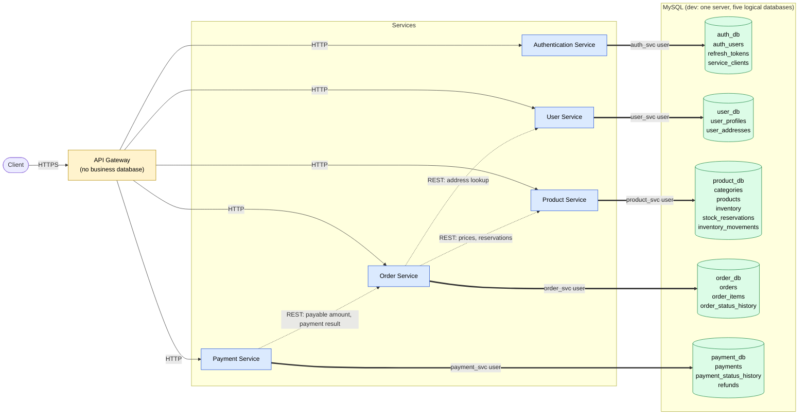

# Database Ownership Model

ShopEase follows the **database-per-service** principle. Each microservice owns one logical
MySQL database. Only that service reads or writes it. Every other service gets the data
through the owner's REST API.

> **Status (2026-10-30): implemented.** The proposal below is the Day 1 design. What was
> actually built (tables, columns, keys, constraints, migrations) is in
> [As Implemented (generated)](#as-implemented-generated), generated from the code; the
> deviations from the proposal and why are in *Day 2 Implementation Notes*.

Related: [service_responsibilities.md](service_responsibilities.md) ·
[implementation_decisions.md](implementation_decisions.md) (ADR-02, OPEN-02) ·
Diagram source: [database_ownership.mmd](database_ownership.mmd)

---

## Why Database-per-Service

| Benefit | How ownership delivers it |
|---------|---------------------------|
| **Independent deployments** | A service can ship a new version, including schema changes, without coordinating releases with other services. Other services depend on its **API contract**, not its tables. |
| **Schema evolution** | The owner can rename columns, split tables or change indexes freely, as long as its API stays compatible. If other services read the tables, every schema change would become a cross-team breaking change. |
| **Security** | Each service has its own database credentials with privileges on **only** its own database. A compromised product_service can't read password hashes in auth_db or payment records in payment_db. |
| **Team autonomy** | The team that owns a service owns its data model, migrations, performance tuning and data quality, with no shared-schema meetings. |
| **Fault and load isolation** | A heavy query or lock in one database doesn't block other services' tables. It is fully isolated only when databases are on separate physical servers (see Section 1). |

The cost: no cross-service joins, no cross-service ACID transactions, and data that is
spread out and sometimes duplicated (snapshots). These are handled with API calls, stored
identifiers and eventual consistency (Sections 3, 4 and 7).

---

## Logical Database Allocation

| Service | Logical database | Owner (only writer and reader) |
|---------|------------------|--------------------------------|
| Authentication Service | `auth_db` | auth_service |
| User Service | `user_db` | user_service |
| Product Service | `product_db` | product_service |
| Order Service | `order_db` | order_service |
| Payment Service | `payment_db` | payment_service |
| API Gateway | **none** | — |

**The API Gateway owns no business database.** It stores no users, products, orders or
payments. It only holds configuration (the route table, rate-limit rules) and the cached
JWKS. If rate-limit counters need to be shared across several gateway copies later, a cache
such as Redis is infrastructure state, not an e-commerce business database.

---

## Proposed Tables per Database

Column lists are indicative and will be finalized during Day 2 design. `PK` = primary key.
Identifiers that point to other services' data (marked *external*) have **no database
foreign key**.

### `auth_db` — owner: auth_service
| Table | Purpose | Key columns |
|-------|---------|-------------|
| `auth_users` | Login identity and credentials | `id` PK, `email` (unique), `password_hash`, `role`, `status`, `failed_login_attempts`, `locked_until`, `created_at` |
| `refresh_tokens` | Issued refresh tokens and their revocation | `id` PK, `user_id` → `auth_users.id`, `token_hash` (unique), `expires_at`, `revoked_at`, `replaced_by_id` |
| `service_clients` | Internal service identities for service tokens (ADR-08) | `client_id` PK, `secret_hash`, `allowed_scopes`, `active` |

Access tokens are short-lived and are not stored. If immediate access-token revocation is
needed later, add a `token_revocations` table (`jti`, `expires_at`).

### `user_db` — owner: user_service
| Table | Purpose | Key columns |
|-------|---------|-------------|
| `user_profiles` | Profile and contact details | `user_id` PK (*external*: `auth_users.id`, taken from the JWT `sub`), `full_name`, `phone`, `contact_email`, `created_at`, `updated_at` |
| `user_addresses` | Delivery addresses | `id` PK, `user_id` → `user_profiles.user_id`, `label`, `line1`, `line2`, `city`, `state`, `postal_code`, `country`, `is_default` |

### `product_db` — owner: product_service
| Table | Purpose | Key columns |
|-------|---------|-------------|
| `categories` | Product categories | `id` PK, `name` (unique), `parent_id` → `categories.id` |
| `products` | Catalog and current price | `id` PK, `sku` (unique), `name`, `description`, `category_id` → `categories.id`, `price`, `currency`, `status` |
| `inventory` | Current stock level per product | `product_id` PK → `products.id`, `quantity_on_hand`, `quantity_reserved`, `version` (optimistic locking) |
| `stock_reservations` | Stock held for orders in checkout | `id` PK, `order_id` (*external*), `product_id` → `products.id`, `quantity`, `status`, `expires_at`; unique (`order_id`, `product_id`) for idempotency |
| `inventory_movements` | Append-only audit record of every stock change | `id` PK, `product_id` → `products.id`, `change`, `reason` (RESTOCK, RESERVE, CONFIRM, RELEASE, ADJUST), `reference_id` (*external*, e.g. `order_id`), `created_at` |

### `order_db` — owner: order_service
| Table | Purpose | Key columns |
|-------|---------|-------------|
| `orders` | Order header | `id` PK, `user_id` (*external*), `status`, `total_amount`, `currency`, `shipping_address_snapshot` (JSON), `idempotency_key` (unique per user), `payment_id` (*external*), `payment_due_by`, `created_at`, `updated_at` |
| `order_items` | Line items with snapshots | `id` PK, `order_id` → `orders.id`, `product_id` (*external*), `product_name_snapshot`, `unit_price_snapshot`, `quantity` |
| `order_status_history` | Audit record of status changes | `id` PK, `order_id` → `orders.id`, `from_status`, `to_status`, `changed_by`, `reason`, `changed_at` |

### `payment_db` — owner: payment_service
| Table | Purpose | Key columns |
|-------|---------|-------------|
| `payments` | Payment attempts | `id` PK, `order_id` (*external*), `user_id` (*external*), `amount`, `currency`, `status`, `provider`, `provider_txn_ref`, `idempotency_key` (unique), `active_order_id` (unique; set only while the payment is active, so an order can't have two active payments), `card_brand`, `card_last4`, `failure_reason`, `created_at` |
| `payment_status_history` | Audit record of status changes and verified provider events | `id` PK, `payment_id` → `payments.id`, `from_status`, `to_status`, `source` (API, WEBHOOK, RECONCILIATION), `provider_event_id` (unique, for deduplication), `created_at` |
| `refunds` | Refunds against a payment | `id` PK, `payment_id` → `payments.id`, `amount`, `status`, `provider_refund_ref`, `reason`, `created_at` |

**Never stored:** raw card numbers (PAN), CVV/CVC, PINs or provider secret keys. Only the
provider's token or reference, the card brand and the last 4 digits.

### Ownership check
Every table appears in exactly one database, and every database has exactly one owning
service. Foreign keys exist **only inside** a database (for example,
`order_items.order_id → orders.id`), never between databases.

---

## Ownership Diagram

Each service connects only to its own database (thick arrows). Dashed arrows are **REST API
calls**, the only way data crosses service boundaries. The gateway has no database. The
same diagram is in [database_ownership.mmd](database_ownership.mmd).



---

## 1. Logical vs. Physical Separation

- **Logical separation** means ownership and access boundaries. Each service has its own
  database (in MySQL, "database" and "schema" mean the same thing), its own credentials and
  its own migrations. No other service can read or write it.
- **Physical separation** means where the data actually runs: one MySQL server hosting all
  five databases, or separate servers or instances for each.

Database-per-service is a **logical** rule. It does not require five MySQL servers.

| Setup | Isolation | When to use |
|-------|-----------|-------------|
| One MySQL server, five databases, one DB user per service | Logical: access and schema isolation; CPU, memory, connections and outages are shared | **ShopEase development (proposed answer to OPEN-02)** |
| Separate MySQL instance per service (or per group of services) | Logical and physical: resources and failures are isolated | Production, for busy or sensitive services (e.g. payment_db) |

Because services only know their own connection string (`DATABASE_URL` from configuration),
moving a database to its own server later is a configuration change, not a code change.

## 2. Why a Service Must Not Query Another Service's Tables

- **Hidden coupling:** the reader depends on the owner's internal schema. A harmless rename
  by the owner breaks the reader at runtime, and nobody knows it until production.
- **Bypassed business rules:** reading `products.price` directly skips the owner's rules
  (archived products, currency handling). Writing `inventory` directly skips stock checks
  and the audit trail in `inventory_movements`, so stock could go negative or be double-reserved.
- **Lost independent deployment:** two services sharing tables must deploy and migrate
  together. That is a distributed monolith.
- **Security:** it would need credentials that reach beyond the service's own data, which
  widens the damage from any breach.
- **No clear source of truth:** with several writers, nobody owns data quality.

This is enforced **technically** (database privileges, Section 5), not just by convention.

## 3. Getting Cross-Service Information Through APIs

When a service needs data it doesn't own, it calls the owner's API.

| Need | Caller | API call |
|------|--------|----------|
| Current prices and availability at checkout | order_service | `POST /internal/products/price-check` (product_service) |
| Reserve, confirm, release stock | order_service | `POST /internal/reservations...` (product_service) |
| Delivery address for an order | order_service | `GET /internal/users/{user_id}/addresses/{address_id}` (user_service) |
| Payable amount and owner of an order | payment_service | `GET /internal/orders/{order_id}/payable` (order_service) |
| Report a payment outcome | payment_service | `POST /internal/orders/{order_id}/payment-result` (order_service) |
| Show product names on an order | client | Already stored on the order as a snapshot; no call needed |

Guidelines:
- **Batch requests:** one call with a list of product IDs, not one call per item (avoid N+1
  calls across the network).
- **Snapshot data that must not change:** store the price, name and address on the order at
  checkout instead of looking them up later.
- **Cache read-mostly data carefully,** with a short time-to-live, and never for stock
  decisions.
- **Treat every call as able to fail:** use timeouts, limited retries for idempotent calls,
  and clear error mapping (Section 7).

## 4. Storing Foreign Identifiers Without Cross-Database Foreign Keys

- Store the other service's ID as a plain column (for example, `orders.user_id`,
  `order_items.product_id`, `payments.order_id`) with an **index**, but **no `FOREIGN KEY`
  constraint** across databases. MySQL can technically define foreign keys across
  databases on one server, but ShopEase forbids it: it would couple services and stop working
  the moment a database moves to another server.
- **Validate at write time through the API:** order_service confirms products exist through
  product_service before saving `order_items`. The user ID comes from the verified JWT
  `sub`, not from the request body.
- **Use one consistent ID format** across services so references are unambiguous. UUIDs are
  proposed: they can be created independently by each service and don't reveal record
  counts. See OPEN-12.
- **Plan for missing or deleted references:** owners should **soft-delete or archive**
  (products get `status = ARCHIVED`, not a row deletion), so old orders still refer to
  something meaningful. Snapshots make orders readable even if the source record changes.
- **Integrity is the application's job:** periodic checks (for example, payments whose
  `order_id` no longer matches a known order) replace what a database foreign key would have
  guaranteed.

## 5. Isolating Credentials and Database Permissions

| Principle | Proposal |
|-----------|----------|
| One application user per service | `auth_svc`, `user_svc`, `product_svc`, `order_svc`, `payment_svc` |
| Least privilege at runtime | Each application user gets only `SELECT, INSERT, UPDATE, DELETE` on **its own** database. No `CREATE/ALTER/DROP`, no access to other databases. |
| Separate migration user | A per-service migration user (e.g. `order_migrator`) has DDL rights on its own database only, used by Alembic during deployment, not by the running app. |
| No shared or admin accounts | Services never connect as `root`. Admin accounts are for database administrators only. |
| Secrets outside code | Passwords come from environment variables or a secret store. Only placeholders go in `.env.example`; real values never go in Git. |
| Secret rotation | Each service's credentials can be rotated without affecting the others. |
| Encryption in transit | TLS between services and MySQL in shared or production environments. |
| Network exposure | MySQL is not published to the host or internet outside local development. |

Illustrative privilege model (documentation only, **not executed on Day 1**):

```sql
-- Runtime user for order_service: data access, own database only
GRANT SELECT, INSERT, UPDATE, DELETE ON order_db.* TO 'order_svc'@'%';
-- Migration user for order_service: schema changes, own database only
GRANT CREATE, ALTER, DROP, INDEX, REFERENCES, SELECT, INSERT, UPDATE, DELETE
      ON order_db.* TO 'order_migrator'@'%';
-- Deliberately absent: any grant on product_db, user_db, payment_db or auth_db
```

With these grants, even a bug in order_service that tries to update `product_db.inventory`
gets an access-denied error from MySQL.

## 6. Independent Schema Migrations

- **One Alembic setup per service,** stored in the service's own folder. Each service's
  migration history (its `alembic_version` table) lives in its own database, so the five
  histories never collide.
- **No shared migration scripts** and no migration that touches another service's database.
- **Migrations run with that service's deployment,** using its migration user, before the
  new version takes traffic.
- **Expand-and-contract for zero-downtime changes:**
  1. *Expand:* add the new column or table, nullable or with a default. Old and new code
     both work.
  2. *Migrate:* deploy code that writes both and reads the new one; backfill data.
  3. *Contract:* once nothing uses the old column, remove it in a later release.
- **Schema changes are internal; API changes are contracts.** A schema change that doesn't
  change the API needs no coordination. One that does needs API versioning or a
  backward-compatible addition.
- **Review and rollback:** migrations are reviewed like code. Destructive steps (dropping
  columns or tables) happen only after a backup and only in the contract phase.

## 7. Eventual Consistency and Failed Requests in Business Workflows

Without one database transaction across services, checkout is a **saga**: a series of local
transactions. ShopEase uses the **two-step checkout** (ADR-13, accepted): order_service
coordinates the order and stock steps, and payment_service coordinates the payment steps
and reports results to order_service. Between steps, the data in different databases may
briefly disagree. That is **eventual consistency**, and the workflow is designed to reach a
correct end state. The full sequence is in
[service_communication.md](service_communication.md) and
[checkout_sequence.mmd](checkout_sequence.mmd).

**Checkout steps and compensations**

| Step | Database written | If this step fails | Compensation for earlier steps |
|------|------------------|--------------------|--------------------------------|
| 1. Create order `PENDING` | order_db | Return error; nothing else happened | — |
| 2. Reserve stock, order → `AWAITING_PAYMENT` | product_db, order_db | Out of stock: order → `CANCELLED` (`409`). Timeout: release (idempotent), order → `CANCELLED` (`503`) | — |
| 3. Record payment `INITIATED`, charge the provider | payment_db | Declined: payment → `FAILED`; order stays `AWAITING_PAYMENT` (retry allowed) | Stock is released when the order expires |
| 4. Payment `SUCCEEDED`, report to order_service | payment_db | Report fails: background retry (bounded) | — |
| 5. Confirm stock, order → `PAID` | product_db, order_db | Reservation expired: order → `CANCELLED`, order_service answers `409` | payment_service **refunds** the payment → `REFUNDED` |
| — Order never paid | order_db, product_db | Expiry job: order → `CANCELLED` | Release the stock reservation |

**How failures affect the workflow**

- **Timeouts with unknown outcome:** if payment_service times out calling the provider, the
  charge may or may not have happened. It must **not** charge again blindly. The payment
  becomes `PROCESSING`, the client gets `202`, and a reconciliation job checks the provider
  status on a bounded schedule, using the same provider idempotency key.
- **Idempotency everywhere:** reservations are unique per (`order_id`, `product_id`),
  payments are unique per `idempotency_key`, and provider events are unique per
  `provider_event_id`. A retry gives the same result instead of creating duplicates.
- **Reservation expiry:** if order_service crashes mid-checkout, product_service releases
  expired reservations itself, so stock is never locked forever.
- **Reconciliation:** payment_service resolves `PROCESSING` payments with the provider and
  reports the result. order_service's expiry job cancels orders that stay `AWAITING_PAYMENT`
  past `payment_due_by`. A successful payment that arrives late is refunded.
- **One active payment per order:** `payments.active_order_id` is unique, so two parallel
  payment requests with different idempotency keys can't both charge.
- **Visible intermediate states:** the API and UI show `PENDING` and `AWAITING_PAYMENT`
  honestly, and customers are not told "paid" until payment_service confirms.
- **Audit trails** (`order_status_history`, `payment_status_history`, `inventory_movements`)
  make it possible to explain and repair any inconsistency after the fact.
- **Not solved by these patterns:** two-phase commit across MySQL databases is deliberately
  not used. It would couple services' availability and break if databases are moved to
  separate servers.

A message broker with the **transactional outbox** pattern would make step-to-step delivery
more reliable later (OPEN-05). It is not needed for the Day 2 scope.

---

## Day 2 Implementation Notes (2026-10-30)

The tables above are implemented as SQLAlchemy models and one initial Alembic migration per
service (`<svc>_0001`). Setup and run commands: [database_setup.md](database_setup.md).
These details were decided or changed during implementation (ADR-15):

| Area | As implemented |
|------|----------------|
| IDs | UUID (OPEN-12 proposal), generated by the service, stored as `CHAR(32)` (hex) |
| Timestamps | `DATETIME(6)` holding UTC; the models reject naive datetimes and return aware UTC |
| Money | `DECIMAL(12,2)` plus a 3-letter `currency` |
| Enumerations | `VARCHAR(32)` plus a named `CHECK` constraint (e.g. `ck_orders_status`), values as listed below |
| `inventory_movements.change` | Renamed **`quantity_change`**: `CHANGE` is a reserved word in MySQL |
| `inventory_movements` audit columns (`product_0002`) | `reserved_change`, `on_hand_after`, `reserved_after`, `actor`, `note`; the check is now `quantity_change <> 0 OR reserved_change <> 0`. RESERVE and RELEASE change only `reserved_change`; CONFIRM changes both |
| `stock_reservations.status` | `RESERVED`, `CONFIRMED`, `RELEASED`, `EXPIRED` |
| `products.status` / `auth_users.status` / `auth_users.role` | `ACTIVE`, `ARCHIVED` / `ACTIVE`, `DISABLED` / `customer`, `admin` |
| `refunds.status` | `PENDING`, `PROCESSING`, `SUCCEEDED`, `FAILED` |
| Added: `orders.request_fingerprint`, `payments.request_fingerprint` | SHA-256 of the request body, so "same Idempotency-Key, different body" can return `409` (rest_api_notes §1.7) |
| Added: `refunds.idempotency_key` (unique) | Makes compensating refunds safe to retry |
| Added: `payments.result_reported_at` | `NULL` until order_service acknowledges the result; drives the bounded retry of payment-result reports |
| Added: `payments` unique (`provider`, `provider_txn_ref`), check `active_order_id IS NULL OR active_order_id = order_id` | Provider references can't be recorded twice; the one-active-payment rule can't point at another order |
| Added: `inventory` checks | `quantity_on_hand >= 0`, `quantity_reserved >= 0`, `quantity_reserved <= quantity_on_hand` |
| Added: `orders` unique (`user_id`, `idempotency_key`), `order_items` unique (`order_id`, `product_id`) | Idempotency per user; one line per product, matching stock reservations |
| Foreign-key delete rules | `CASCADE` only for `refresh_tokens` and `user_addresses`; financial and audit rows are never deleted, so their foreign keys restrict deletes |
| Not enforced by the database | "At most one default address per user" (MySQL has no partial unique index); user_service enforces it in the same transaction |

Verified on MySQL 8.0.46 (a disposable instance): 12 foreign keys, all inside their own
database, none across databases; 26 CHECK constraints; the runtime users have only
`SELECT, INSERT, UPDATE, DELETE` on their own database, and no user can see another
service's database.

---

<!-- implemented-schema:start -->

## As Implemented (generated)

Generated by `python scripts/export_schema.py` from the models and migrations. MySQL types
as created by the migrations. **FK** = foreign key inside the same database; columns
marked *external* hold another service's ID and have no foreign key.

| Database | Owner | Tables | Migrations (in order) | Migrate |
|----------|-------|--------|-----------------------|---------|
| `auth_db` | auth_service | 3 | auth_0001 | `docker compose run --rm auth_migrate` |
| `user_db` | user_service | 2 | user_0001 | `docker compose run --rm user_migrate` |
| `product_db` | product_service | 5 | product_0001, product_0002 | `docker compose run --rm product_migrate` |
| `order_db` | order_service | 3 | order_0001, order_0002 | `docker compose run --rm order_migrate` |
| `payment_db` | payment_service | 3 | payment_0001, payment_0002 | `docker compose run --rm payment_migrate` |

### `auth_db` (auth_service)

**`auth_users`**

| Column | Type | Null | Key |
|--------|------|------|-----|
| `id` | CHAR(32) | no | PK |
| `email` | VARCHAR(254) | no |  |
| `password_hash` | VARCHAR(255) | no |  |
| `role` | VARCHAR(32) | no |  |
| `status` | VARCHAR(32) | no |  |
| `failed_login_attempts` | INTEGER | no |  |
| `locked_until` | DATETIME(6) | yes |  |
| `created_at` | DATETIME(6) | no |  |
| `updated_at` | DATETIME(6) | no |  |

unique: (email); checks: `ck_auth_users_failed_login_attempts_non_negative`, `ck_auth_users_role`, `ck_auth_users_status`

**`service_clients`**

| Column | Type | Null | Key |
|--------|------|------|-----|
| `client_id` | VARCHAR(64) | no | PK |
| `secret_hash` | VARCHAR(255) | no |  |
| `allowed_scopes` | JSON | no |  |
| `active` | BOOL | no |  |
| `created_at` | DATETIME(6) | no |  |
| `updated_at` | DATETIME(6) | no |  |

**`refresh_tokens`**

| Column | Type | Null | Key |
|--------|------|------|-----|
| `id` | CHAR(32) | no | PK |
| `user_id` | CHAR(32) | no | FK → `auth_users.id` |
| `token_hash` | VARCHAR(64) | no |  |
| `expires_at` | DATETIME(6) | no |  |
| `revoked_at` | DATETIME(6) | yes |  |
| `replaced_by_id` | CHAR(32) | yes | FK → `refresh_tokens.id` |
| `created_at` | DATETIME(6) | no |  |

unique: (token_hash); indexes: (expires_at); (user_id); (replaced_by_id)


### `user_db` (user_service)

**`user_profiles`**

| Column | Type | Null | Key |
|--------|------|------|-----|
| `user_id` | CHAR(32) | no | PK |
| `full_name` | VARCHAR(200) | yes |  |
| `phone` | VARCHAR(32) | yes |  |
| `contact_email` | VARCHAR(254) | yes |  |
| `created_at` | DATETIME(6) | no |  |
| `updated_at` | DATETIME(6) | no |  |

**`user_addresses`**

| Column | Type | Null | Key |
|--------|------|------|-----|
| `id` | CHAR(32) | no | PK |
| `user_id` | CHAR(32) | no | FK → `user_profiles.user_id` |
| `label` | VARCHAR(50) | yes |  |
| `line1` | VARCHAR(200) | no |  |
| `line2` | VARCHAR(200) | yes |  |
| `city` | VARCHAR(100) | no |  |
| `state` | VARCHAR(100) | yes |  |
| `postal_code` | VARCHAR(20) | no |  |
| `country` | VARCHAR(2) | no |  |
| `is_default` | BOOL | no |  |
| `created_at` | DATETIME(6) | no |  |
| `updated_at` | DATETIME(6) | no |  |

indexes: (user_id, is_default)


### `product_db` (product_service)

**`categories`**

| Column | Type | Null | Key |
|--------|------|------|-----|
| `id` | CHAR(32) | no | PK |
| `name` | VARCHAR(100) | no |  |
| `parent_id` | CHAR(32) | yes | FK → `categories.id` |
| `created_at` | DATETIME(6) | no |  |
| `updated_at` | DATETIME(6) | no |  |

unique: (name); indexes: (parent_id)

**`products`**

| Column | Type | Null | Key |
|--------|------|------|-----|
| `id` | CHAR(32) | no | PK |
| `sku` | VARCHAR(64) | no |  |
| `name` | VARCHAR(200) | no |  |
| `description` | TEXT | yes |  |
| `category_id` | CHAR(32) | yes | FK → `categories.id` |
| `price` | NUMERIC(12, 2) | no |  |
| `currency` | VARCHAR(3) | no |  |
| `status` | VARCHAR(32) | no |  |
| `created_at` | DATETIME(6) | no |  |
| `updated_at` | DATETIME(6) | no |  |

unique: (sku); indexes: (category_id); (status, category_id); checks: `ck_products_price_non_negative`, `ck_products_status`

**`inventory`**

| Column | Type | Null | Key |
|--------|------|------|-----|
| `product_id` | CHAR(32) | no | PK FK → `products.id` |
| `quantity_on_hand` | INTEGER | no |  |
| `quantity_reserved` | INTEGER | no |  |
| `version` | INTEGER | no |  |
| `updated_at` | DATETIME(6) | no |  |

checks: `ck_inventory_on_hand_non_negative`, `ck_inventory_reserved_non_negative`, `ck_inventory_reserved_within_on_hand`

**`inventory_movements`**

| Column | Type | Null | Key |
|--------|------|------|-----|
| `id` | CHAR(32) | no | PK |
| `product_id` | CHAR(32) | no | FK → `products.id` |
| `quantity_change` | INTEGER | no |  |
| `reserved_change` | INTEGER | no |  |
| `on_hand_after` | INTEGER | yes |  |
| `reserved_after` | INTEGER | yes |  |
| `reason` | VARCHAR(32) | no |  |
| `reference_id` | CHAR(32) | yes | *external* |
| `actor` | VARCHAR(64) | no |  |
| `note` | VARCHAR(255) | yes |  |
| `created_at` | DATETIME(6) | no |  |

indexes: (product_id, created_at); (product_id); (reference_id); checks: `ck_inventory_movements_has_change`, `ck_inventory_movements_reason`

**`stock_reservations`**

| Column | Type | Null | Key |
|--------|------|------|-----|
| `id` | CHAR(32) | no | PK |
| `order_id` | CHAR(32) | no | *external* |
| `product_id` | CHAR(32) | no | FK → `products.id` |
| `quantity` | INTEGER | no |  |
| `status` | VARCHAR(32) | no |  |
| `expires_at` | DATETIME(6) | no |  |
| `created_at` | DATETIME(6) | no |  |
| `updated_at` | DATETIME(6) | no |  |

unique: (order_id, product_id); indexes: (status, expires_at); (product_id); checks: `ck_stock_reservations_quantity_positive`, `ck_stock_reservations_status`


### `order_db` (order_service)

**`orders`**

| Column | Type | Null | Key |
|--------|------|------|-----|
| `id` | CHAR(32) | no | PK |
| `user_id` | CHAR(32) | no | *external* |
| `status` | VARCHAR(32) | no |  |
| `total_amount` | NUMERIC(12, 2) | no |  |
| `currency` | VARCHAR(3) | no |  |
| `shipping_address_snapshot` | JSON | no |  |
| `idempotency_key` | VARCHAR(64) | no |  |
| `request_fingerprint` | VARCHAR(64) | no |  |
| `payment_id` | CHAR(32) | yes | *external* |
| `payment_due_by` | DATETIME(6) | yes |  |
| `payment_status` | VARCHAR(32) | no |  |
| `cancel_reason` | VARCHAR(64) | yes |  |
| `release_pending` | BOOL | no |  |
| `created_at` | DATETIME(6) | no |  |
| `updated_at` | DATETIME(6) | no |  |

unique: (user_id, idempotency_key); indexes: (release_pending); (payment_id); (status, created_at); (user_id, created_at); (status, payment_due_by); checks: `ck_orders_payment_status`, `ck_orders_status`, `ck_orders_total_amount_non_negative`

**`order_items`**

| Column | Type | Null | Key |
|--------|------|------|-----|
| `id` | CHAR(32) | no | PK |
| `order_id` | CHAR(32) | no | FK → `orders.id` |
| `product_id` | CHAR(32) | no | *external* |
| `product_name_snapshot` | VARCHAR(200) | no |  |
| `unit_price_snapshot` | NUMERIC(12, 2) | no |  |
| `quantity` | INTEGER | no |  |

unique: (order_id, product_id); indexes: (product_id); checks: `ck_order_items_quantity_positive`, `ck_order_items_unit_price_non_negative`

**`order_status_history`**

| Column | Type | Null | Key |
|--------|------|------|-----|
| `id` | CHAR(32) | no | PK |
| `order_id` | CHAR(32) | no | FK → `orders.id` |
| `from_status` | VARCHAR(32) | yes |  |
| `to_status` | VARCHAR(32) | no |  |
| `changed_by` | VARCHAR(64) | no |  |
| `reason` | VARCHAR(255) | yes |  |
| `changed_at` | DATETIME(6) | no |  |

indexes: (order_id, changed_at); checks: `ck_order_status_history_from_status`, `ck_order_status_history_to_status`


### `payment_db` (payment_service)

**`payments`**

| Column | Type | Null | Key |
|--------|------|------|-----|
| `id` | CHAR(32) | no | PK |
| `order_id` | CHAR(32) | no | *external* |
| `user_id` | CHAR(32) | no | *external* |
| `amount` | NUMERIC(12, 2) | no |  |
| `currency` | VARCHAR(3) | no |  |
| `status` | VARCHAR(32) | no |  |
| `provider` | VARCHAR(32) | no |  |
| `provider_txn_ref` | VARCHAR(128) | yes |  |
| `idempotency_key` | VARCHAR(64) | no |  |
| `request_fingerprint` | VARCHAR(64) | no |  |
| `active_order_id` | CHAR(32) | yes | *external* |
| `card_brand` | VARCHAR(20) | yes |  |
| `card_last4` | VARCHAR(4) | yes |  |
| `failure_reason` | VARCHAR(255) | yes |  |
| `result_reported_at` | DATETIME(6) | yes |  |
| `report_attempts` | INTEGER | no |  |
| `next_report_at` | DATETIME(6) | yes |  |
| `reconcile_attempts` | INTEGER | no |  |
| `next_reconcile_at` | DATETIME(6) | yes |  |
| `needs_manual_review` | BOOL | no |  |
| `created_at` | DATETIME(6) | no |  |
| `updated_at` | DATETIME(6) | no |  |

unique: (provider, provider_txn_ref); (active_order_id); (idempotency_key); indexes: (status, next_reconcile_at); (user_id); (status, updated_at); (next_report_at); (order_id); checks: `ck_payments_active_order_matches`, `ck_payments_amount_positive`, `ck_payments_status`

**`payment_status_history`**

| Column | Type | Null | Key |
|--------|------|------|-----|
| `id` | CHAR(32) | no | PK |
| `payment_id` | CHAR(32) | no | FK → `payments.id` |
| `from_status` | VARCHAR(32) | yes |  |
| `to_status` | VARCHAR(32) | no |  |
| `source` | VARCHAR(32) | no |  |
| `provider_event_id` | VARCHAR(128) | yes | *external* |
| `created_at` | DATETIME(6) | no |  |

unique: (provider_event_id); indexes: (payment_id); checks: `ck_payment_status_history_from_status`, `ck_payment_status_history_source`, `ck_payment_status_history_to_status`

**`refunds`**

| Column | Type | Null | Key |
|--------|------|------|-----|
| `id` | CHAR(32) | no | PK |
| `payment_id` | CHAR(32) | no | FK → `payments.id` |
| `amount` | NUMERIC(12, 2) | no |  |
| `status` | VARCHAR(32) | no |  |
| `provider_refund_ref` | VARCHAR(128) | yes |  |
| `reason` | VARCHAR(255) | yes |  |
| `idempotency_key` | VARCHAR(64) | no |  |
| `created_at` | DATETIME(6) | no |  |
| `updated_at` | DATETIME(6) | no |  |

unique: (idempotency_key); indexes: (payment_id); checks: `ck_refunds_amount_positive`, `ck_refunds_status`


Migration commands: [database_setup.md](database_setup.md) and [local_development.md](local_development.md) §4.

<!-- implemented-schema:end -->

---

## Validation Checklist

- [x] Five logical databases, each with exactly one owning service.
- [x] The API Gateway has no business database.
- [x] Every table appears in exactly one database.
- [x] No foreign keys between databases; external IDs are plain indexed columns.
- [x] Each service's database user has privileges on its own database only.
- [x] One Alembic history per service.
- [x] The diagram shows each service connected only to its own database.
- [x] No databases created, no migrations run, no models written (Day 1).
