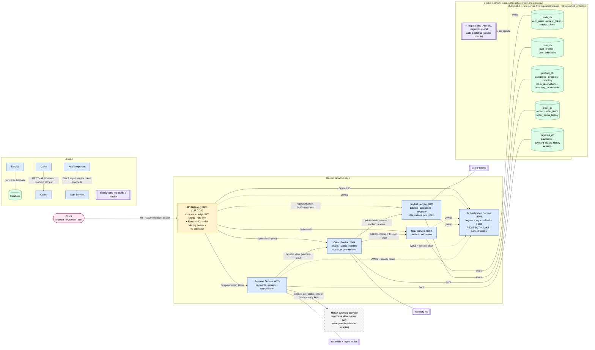

# ShopEase — Final Architecture (as implemented)

ShopEase is a microservices e-commerce backend: five FastAPI business services, each owning
one logical MySQL database, behind a single FastAPI API Gateway, packaged with Docker Compose.
This document describes what was **built and verified** on 2026-10-30, and how it compares
with the approved Day 1 design ([shopease_architecture.md](shopease_architecture.md)).

Diagram source: [final_architecture.mmd](final_architecture.mmd) · Endpoints:
[api_reference.md](api_reference.md) · Tables: [database_ownership.md](database_ownership.md) ·
Tests: [testing_report.md](testing_report.md)

---

## 1. Diagram

**Solid lines without arrowheads** = database ownership · **labelled arrows** = HTTP calls ·
**dotted arrows** = public keys and service tokens from auth_service (cached) ·
**double-bordered boxes** = background jobs · **dashed box** = the in-process **mock**
payment provider.

## 2. Components

| Component | Port | Database | Responsibilities (implemented) |
|-----------|------|----------|-------------------------------|
| API Gateway | 8000 | none | Route map, edge access-token check, per-IP rate limits, request IDs, strips spoofable identity headers, per-route timeouts, hides upstream internals, CORS when configured |
| Authentication Service | 8001 | `auth_db` | Register, login (Argon2id, lockout), RS256 access tokens + JWKS, refresh rotation with reuse detection, logout, password change, roles, client-credentials service tokens |
| User Service | 8002 | `user_db` | Profile created on first access, addresses (owner-only), admin profile read, internal address lookup (scope + forwarded user token) |
| Product Service | 8003 | `product_db` | Catalog, categories, search/filters, admin price and stock changes, audited inventory, all-or-nothing reservations with row locks, confirm/release, expiry sweep |
| Order Service | 8004 | `order_db` | Server-side pricing and snapshots, idempotent order creation, stock reservation and compensation, status machine and history, payable view, payment results, recovery job |
| Payment Service | 8005 | `payment_db` | Idempotent payments, one active payment per order, mock provider adapter, reconciliation of unknown outcomes, result reporting with retries, automatic and admin refunds |
| MySQL 8.4 | not published | 5 logical databases | Runtime user (DML) and migration user (DDL) per service, own database only |

## 3. Day 1 design vs. implementation

| Day 1 decision | Status | Notes |
|----------------|--------|-------|
| Microservices + database per service (ADR-01, ADR-02) | **Implemented, verified** | Grants checked on MySQL: no user can see another service's database; no code references another service's database |
| Synchronous REST between services (ADR-04), acyclic graph (ADR-11) | **Implemented** | order → product, order → user, payment → order; nothing calls payment or the gateway |
| JWT at the gateway and in every service (ADR-05), RS256 + JWKS (OPEN-06) | **Implemented, verified** | Shared verifier pins RS256, issuer, audience, expiry and `token_use` |
| Authenticated service-to-service calls (ADR-08) | **Implemented, verified** | Client-credentials service tokens with scopes; forwarded user token for address lookups |
| Lazy profiles (ADR-09) | **Implemented** | |
| `/api` prefix, gateway forwards unchanged (ADR-12) | **Implemented, verified** | 36 of 37 public routes exercised through the gateway |
| Two-step checkout (ADR-13, accepted) | **Implemented, verified** | Order Service never calls Payment Service |
| Reserve stock at order creation with expiry (OPEN-09) | **Implemented, verified** | Concurrency proven on MySQL (ADR-17) |
| Idempotency keys for orders and payments | **Implemented, verified** | Unique in storage; concurrent duplicates produce one order / one charge |
| Unknown payment outcome → reconcile, never re-charge | **Implemented, verified** | Mock timeout scenario reconciled end to end |
| Payment provider | **Mock only** | Real provider = future adapter behind `PaymentProvider` (ADR-19) |
| Webhooks from the provider | **Not implemented** | Route answers `501`; reconciliation is the only status source |
| Message broker / transactional outbox (OPEN-05) | **Not implemented** (out of scope) | Recovery jobs cover lost steps |
| Docker Compose deployment | **Implemented, verified** | Healthchecks, startup order, restarts, isolated networks |

Deviations made during implementation, each recorded as an ADR or note:
prices and address are validated **before** the order row is stored (ADR-18);
inventory movements gained audit columns (`product_0002`); orders gained `payment_status`,
`cancel_reason`, `release_pending` (`order_0002`); payments gained reconciliation tracking
(`payment_0002`); Product Service sessions use READ COMMITTED to avoid gap-lock deadlocks
(ADR-17); payment status names stayed `INITIATED`/`PROCESSING` (= pending /
requires reconciliation, ADR-19).

## 4. Request path and trust boundaries

1. **Edge (gateway):** rate limit → authenticate the access token (non-public routes) → body
   size limit → forward with method, path, query and body unchanged; client identity and
   forwarding headers removed; `X-Request-ID` set.
2. **Service boundary:** every service verifies the token again and **authorizes** (role,
   scope, ownership). Other users' orders, payments and addresses answer `404`.
3. **Internal calls:** `/internal/*` is never routed by the gateway and requires a service
   token with the right scope; user-scoped lookups also need the user's token.
4. **Data:** each service connects with its own least-privilege MySQL user.

Details: [security_model.md](security_model.md), [api_gateway.md](api_gateway.md).

## 5. Checkout, consistency and recovery

`POST /api/orders` → price check (product) → address (user) → order `PENDING` → reserve stock
→ `AWAITING_PAYMENT`. `POST /api/payments` → payable view (order) → charge (mock) →
payment-result → confirm stock → `PAID`. No database transaction is held across a network
call; product_service's reservation decides any race between paying and cancelling.

| Mechanism | Where |
|-----------|-------|
| Row locks in `product_id` order, CHECK constraints, version column, bounded deadlock retries | product_service (ADR-17) |
| Idempotent reserve/confirm/release keyed by `order_id` | product_service |
| Compensation: release stock when a reservation outcome is unknown | order_service |
| Expiry sweep (reservations), recovery job (unpaid/abandoned orders, failed releases) | product_service, order_service |
| Reconciliation of `PROCESSING` payments, retried result reports, automatic refunds | payment_service |

Full sequence and status transitions: [order_workflow.md](order_workflow.md),
[payment_processing.md](payment_processing.md).

## 6. Deployment

Docker Compose (`docker-compose.yml`): MySQL → `*_migrate` jobs → `auth_bootstrap` →
services (healthy when their database is reachable) → gateway. Networks `data` and `edge`;
MySQL unpublished; all published ports on 127.0.0.1; non-root containers; the signing key as
a Compose secret; each container receives only its own credentials. Guide:
[local_development.md](local_development.md).

## 7. Verification summary

See [testing_report.md](testing_report.md) for commands and results: unit and API tests for
every component, MySQL integration and concurrency tests, cross-service tests against a
disposable Docker stack, and the Postman collection run with Newman.

## 8. Known limitations

- Mock payment provider only; no webhooks; no real money can move.
- Access tokens can't be revoked before expiry (15 min); in-memory rate limits per gateway.
- Single MySQL server for development; no replicas, backups or TLS in the local stack.
- Background jobs run in every instance of a service (idempotent but uncoordinated).
- Refunded paid orders don't return stock automatically; no admin tool to resolve payments
  flagged for manual review; no returns workflow.
- No frontend; no CI/CD pipeline; not load-tested; not independently security-reviewed.
