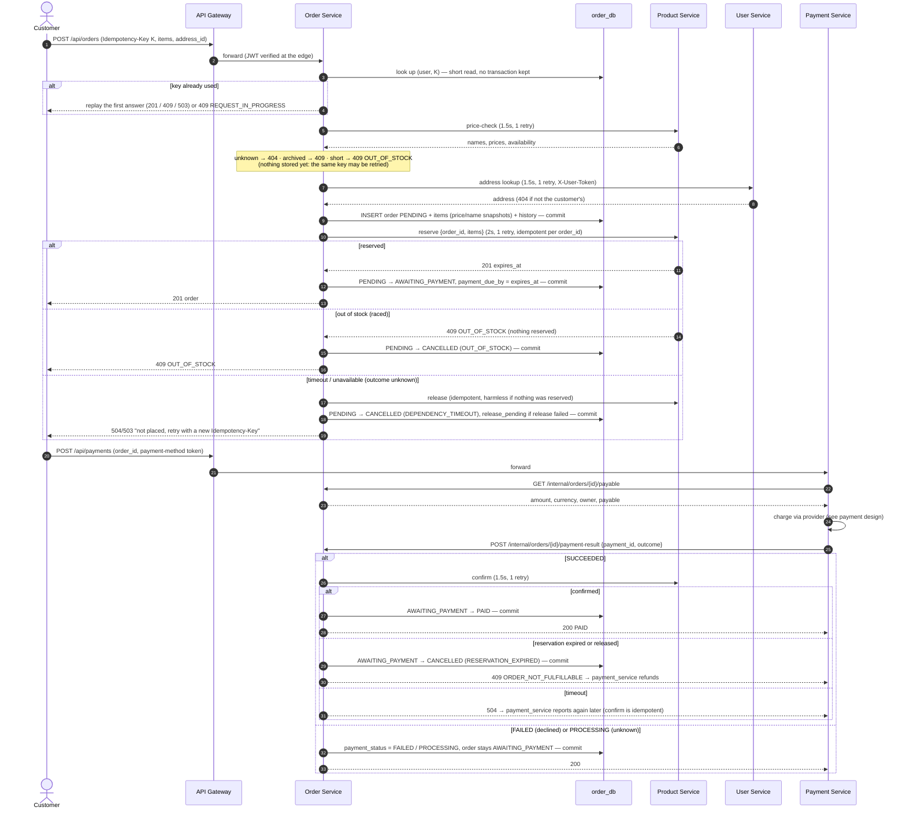

# Order Workflow and Checkout Coordination

How order_service places orders, coordinates stock and payment, and recovers from failures.
Implemented 2026-10-30. Code: `services/order_service/app/orders.py` (rules),
`app/state.py` (status machine), `app/clients.py` (calls to other services).

Related: ADR-13 (two-step checkout, accepted), ADR-17 (inventory), ADR-18 (this design) in
[implementation_decisions.md](implementation_decisions.md) · contracts in
[rest_api_notes.md](rest_api_notes.md) · [service_communication.md](service_communication.md).

---

## 1. Who does what

| Concern | Owner | How |
|---------|-------|-----|
| Prices, product names, availability | product_service | `POST /internal/products/price-check` (scope `products:read`) |
| Holding and deducting stock | product_service | `POST /internal/reservations`, `.../{order_id}/confirm`, `.../{order_id}/release` (scope `inventory:reserve`) |
| Delivery address | user_service | `GET /internal/users/{user_id}/addresses/{address_id}` (scope `addresses:read` + the customer's token in `X-User-Token`) |
| Order, totals, status | **order_service** | `order_db` only |
| Charging the customer | payment_service | Client calls `POST /api/payments`; payment_service reads `GET /internal/orders/{id}/payable` and reports `POST /internal/orders/{id}/payment-result` |

**Payment coordination follows ADR-13 (two-step checkout, accepted 2026-10-29).** order_service
never calls payment_service: the client pays an order that is `AWAITING_PAYMENT`, and
payment_service reports every outcome back. This keeps the dependency graph acyclic
(ADR-11), and a declined card never loses the order or its reserved stock.

order_service never touches another service's database. It authenticates to the others
with a service token (`svc:order`, client credentials, cached until shortly before expiry).

## 2. Checkout sequence



**No transaction is held across a network call.** Every local step is one short transaction
that locks the order row (`SELECT ... FOR UPDATE`), re-checks the status, changes it and
commits. A test probes the database for an open write transaction during every outgoing call.

Differences from the Day 1 sketch: prices and the address are checked **before** the order row
is stored (Day 1 stored `PENDING` first). Failures at that stage leave nothing behind, so the
client may simply retry with the same key.

## 3. Order statuses and transitions

```
               stock reserved                 payment SUCCEEDED + stock confirmed
 PENDING ─────────────────────► AWAITING_PAYMENT ─────────────────────────────► PAID ──► SHIPPED ──► DELIVERED
    │                                │      ▲  payment FAILED / PROCESSING        │ (admin)    (admin)
    │ out of stock, dependency        │      └──(status unchanged, payment_status) │
    │ failure, abandoned (recovery)   │ customer/admin cancel, payment window      │ payment REFUNDED
    ▼                                 ▼ expired, reservation expired at confirm    ▼
 CANCELLED ◄──────────────────────────┴────────────────────────────────────────────┘
```

| From | To | Trigger | Set by |
|------|----|---------|--------|
| — | `PENDING` | Prices and address validated; order stored | order_service (checkout) |
| `PENDING` | `AWAITING_PAYMENT` | Stock reserved; `payment_due_by` = reservation expiry | order_service (checkout) |
| `PENDING` | `CANCELLED` | Out of stock / product unavailable at reservation (`OUT_OF_STOCK`, `PRODUCT_UNAVAILABLE`), reservation outcome unknown (`DEPENDENCY_TIMEOUT`, `DEPENDENCY_UNAVAILABLE`), abandoned mid-checkout (`STUCK_PENDING`) | order_service (checkout, recovery job) |
| `AWAITING_PAYMENT` | `PAID` | payment_service reports `SUCCEEDED` **and** product_service confirms the stock | order_service (payment result) |
| `AWAITING_PAYMENT` | `CANCELLED` | Customer or admin cancels (`CUSTOMER_CANCELLED`, `ADMIN_CANCELLED`); payment window passed (`PAYMENT_TIMEOUT`); stock no longer confirmable when payment arrived (`RESERVATION_EXPIRED`) | customer/admin, recovery job, payment result |
| `PAID` | `SHIPPED` | Fulfilment | admin (`PATCH /api/orders/{id}/status`) |
| `SHIPPED` | `DELIVERED` | Fulfilment | admin |
| `PAID` | `CANCELLED` | payment_service reports `REFUNDED` (`REFUNDED`) | payment result |

Everything else is rejected with `409 INVALID_STATUS_TRANSITION`: leaving `CANCELLED` or
`DELIVERED`, cancelling a paid order directly, shipping an unpaid order, setting `PAID`
through the admin route (`422`: only payments set it). Every change appends an
`order_status_history` row (from, to, who, reason, when).

`payment_status` (`NONE`, `FAILED`, `PROCESSING`, `SUCCEEDED`, `REFUNDED`) records the latest
outcome reported by payment_service; it never replaces the order status. A declined or
uncertain payment leaves the order `AWAITING_PAYMENT` with its stock still reserved.

## 4. Duplicate prevention

| Risk | Protection |
|------|------------|
| Client retries `POST /api/orders` | `Idempotency-Key` header (required, 8–64 chars), unique per user in `order_db`. Same key + same body → the first answer is replayed (`201` with `Idempotent-Replayed: true`, or the original `409`/`503`). Same key + different body → `409 IDEMPOTENCY_KEY_REUSED`. First request still running → `409 REQUEST_IN_PROGRESS`. |
| Two identical requests at the same moment | The unique key settles the race; the loser replays the winner. Verified on MySQL: 6 concurrent submissions → 1 order, stock reserved once. |
| Retried reservation | product_service reservations are unique per `order_id`: a retry returns the same reservation. |
| Payment reported twice | Repeated `SUCCEEDED` with the same `payment_id` → `200`, stock confirmed once. A different `payment_id` for a paid order → `409 ORDER_ALREADY_PAID` (refund it). |
| Duplicate charges | Prevented in payment_service (its own `Idempotency-Key`, one active payment per order, provider idempotency key). An **unknown** outcome is reported as `PROCESSING` and reconciled; order_service never asks for a new charge. |

## 5. Timeouts, retries and compensation

| Call | Connect / read timeout | Retries |
|------|------------------------|---------|
| Service token (auth) | 0.5s / 2s | 1 |
| Price check (product) | 0.5s / 1.5s | 1 (read) |
| Address (user) | 0.5s / 1.5s | 1 (read) |
| Reserve (product) | 0.5s / 2s | 1 (idempotent per `order_id`) |
| Confirm / release (product) | 0.5s / 1.5s | 1 (idempotent), then the recovery job |

- `POST /api/orders` has a **7-second deadline** (the gateway allows 10s); a retry is made
  only if it still fits.
- Connection failures (the request never arrived) are retried; read timeouts only for the
  safe calls above. `4xx` answers are never retried.
- An expired service token (`401`) is refreshed once.

| Failure | Compensation | Final state |
|---------|--------------|-------------|
| Out of stock at reservation | none (nothing reserved) | `CANCELLED` (`OUT_OF_STOCK`), `409` |
| Reservation timed out / unknown | release (idempotent) | `CANCELLED` (`DEPENDENCY_TIMEOUT`), `504`/`503` |
| Release itself failed | `release_pending` flag; recovery job retries; reservation also expires on its own | stock freed later |
| Payment declined | none: stock stays reserved for a retry | `AWAITING_PAYMENT` until paid or expired |
| Payment window passed | recovery job releases stock | `CANCELLED` (`PAYMENT_TIMEOUT`) |
| Payment succeeded but stock expired | stock already returned by product_service; `409 ORDER_NOT_FULFILLABLE` tells payment_service to **refund** | `CANCELLED` (`RESERVATION_EXPIRED`) |
| Payment succeeded, confirm timed out | none yet: `504` to payment_service, which reports again; confirm is idempotent | `PAID` on the next report |
| Customer cancels | release stock **first**; if product says it was already confirmed (a payment won), refuse with `409 PAYMENT_IN_PROGRESS` | `CANCELLED` |

**Races** between a payment result, a cancellation and the expiry job are decided by
product_service: a reservation can be confirmed **or** released, never both (tested under
concurrency in ADR-17). order_service changes its status only after that answer.

### Recovery job
Runs in each order_service process every `ORDER_SWEEP_SECONDS` (30s; 0 disables):
1. `AWAITING_PAYMENT` past `payment_due_by` → release stock → `CANCELLED (PAYMENT_TIMEOUT)`.
   If product says the stock was already confirmed, the order is left alone: a payment
   result is on its way.
2. `PENDING` older than `STUCK_PENDING_SECONDS` (120s; e.g. a crash mid-checkout) → release →
   `CANCELLED (STUCK_PENDING)`.
3. `release_pending` orders → retry the release.

## 6. Not implemented yet (known gaps)

| Scenario | Current behaviour | Needed |
|----------|------------------|--------|
| ~~payment_service itself~~ | **Implemented** (2026-10-30, mock provider): see [payment_processing.md](payment_processing.md). | — |
| Refund of a **paid** order requested by an admin | `PAID → CANCELLED` happens only when payment_service reports `REFUNDED`. There is no admin "cancel and refund" endpoint in order_service. | Admin refund flow in payment_service |
| **Stock return after a refund** of a paid order | Stock deducted at confirm is not put back automatically (product_service has no "return confirmed stock" operation). | A `return` movement in product_service, called on `REFUNDED` |
| Refund after `SHIPPED` | Recorded as `payment_status = REFUNDED`; the order stays `SHIPPED` (returns process not designed). | Returns workflow |
| Expired reservation while a payment is `PROCESSING` | The recovery job cancels the order at `payment_due_by`; if the payment later succeeds, order_service answers `409 ORDER_NOT_FULFILLABLE` and payment_service must refund. Correct, but the customer is charged and refunded. | Optionally extend the reservation while a payment is processing |
| Several order_service instances | Safe (row locks and conditional transitions), but every instance runs the recovery job; work may be attempted twice (harmless, idempotent). | Leader election or `SKIP LOCKED` batching if load grows |
| Transactional outbox | Not used: the steps are synchronous and recoverable by the job above (OPEN-05). | Message broker, later |
| Price change between viewing and ordering | The order uses the price at submission time; the customer isn't asked to confirm a changed price. | Optional `expected_total` check |
