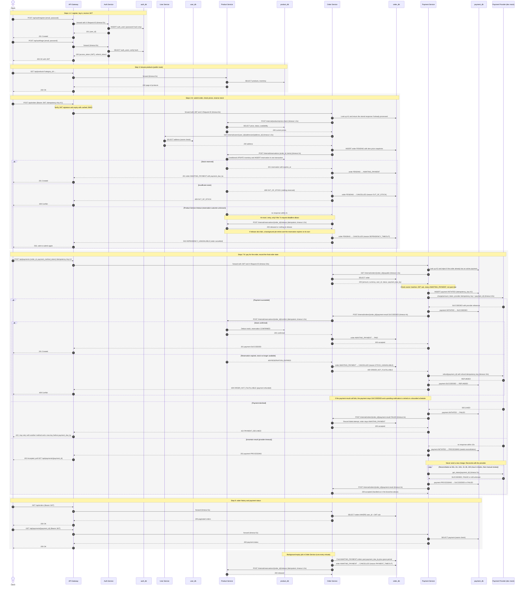

# Service-to-Service Communication and Checkout Workflow

How ShopEase services talk to each other, how they behave when calls fail, and the full
checkout workflow from registration to order history.

> **Status: proposed design, not implemented.** No services were built and no real payment
> requests were made. The payment provider is a **development mock**.
>
> **Checkout model:** this document follows the **two-step checkout**: `POST /api/orders`,
> then `POST /api/payments` (**ADR-13**, accepted 2026-10-29; it replaces
> ADR-10). See [implementation_decisions.md](implementation_decisions.md).

Related: [rest_api_notes.md](rest_api_notes.md) ·
[service_responsibilities.md](service_responsibilities.md) ·
[database_ownership.md](database_ownership.md) ·
Diagram source: [checkout_sequence.mmd](checkout_sequence.mmd)

---

## 1. Communication Styles

| Style | Used for | ShopEase MVP |
|-------|----------|--------------|
| **Synchronous REST over HTTP** | The caller needs the answer to continue (prices, stock reservation, payable amount) | **Yes**, for all service-to-service calls |
| **Asynchronous events (message broker)** | Side effects and notifications that don't need to block the user | **No**, planned for production (Section 10, OPEN-05) |
| **Background jobs inside a service** | Expiry, reconciliation, retrying failed notifications | **Yes**: order expiry, payment reconciliation |

### Who calls whom (synchronous)

| Caller | Callee | Purpose |
|--------|--------|---------|
| API Gateway | all five services | Forwards client requests |
| Order Service | Product Service | Price check, reserve, confirm, release stock |
| Order Service | User Service | Delivery address |
| Payment Service | Order Service | Payable amount; report the payment result |
| Payment Service | Payment Provider (mock) | Charge, check status, refund |
| Every service | Auth Service | JWKS public keys and service tokens (cached) |

**No cycles:** Order Service never calls Payment Service, Product and User Service call
nobody, and no service calls the gateway. Section 11 shows the full check.

### Authentication on every hop
- The gateway verifies the client's JWT (signature, expiry) using Auth Service's public keys
  (RS256 proposed, OPEN-06), fetched from its JWKS endpoint and **cached**. Auth Service is
  not called on each request.
- Each service verifies the forwarded JWT again and makes its own authorization decisions.
- Internal calls also carry a short-lived **service token** with limited scopes (ADR-08). The
  internal network is not trusted on its own.

---

## 2. Checkout Workflow (Steps 1-9)

| Step | What happens | Calls | Data written |
|------|--------------|-------|--------------|
| **1. Register, log in** | Customer registers, then logs in with email and password | Client → Gateway → Auth | `auth_db.auth_users` (password hash only) |
| **2. JWT issued** | Auth Service returns an access token (short-lived JWT: `sub`, `role`, `exp`) and a refresh token | Auth → Gateway → Client | `auth_db.refresh_tokens` |
| **3. Browse** | Public product listing and details | Client → Gateway → Product | — |
| **4. Submit order** | `POST /api/orders` with items, address ID and `Idempotency-Key` | Client → Gateway → Order | `order_db.orders` = `PENDING` |
| **5. Validate** | Order Service gets **current** prices and availability from Product Service (never trusts client prices), and the address from User Service | Order → Product, Order → User | Price and address snapshots on the order |
| **6. Reserve stock** | Inventory strategy: **reserve on order creation, with an expiry** (OPEN-09). Product Service reserves stock in one local transaction; the order becomes `AWAITING_PAYMENT` with `payment_due_by` = reservation expiry | Order → Product | `product_db.stock_reservations`, `inventory`; order → `AWAITING_PAYMENT` |
| **7. Pay** | `POST /api/payments` with `order_id`, a provider payment-method token and `Idempotency-Key`. Payment Service gets the payable amount from Order Service, records the attempt, and charges through the **provider abstraction** (dev mock) | Client → Gateway → Payment → Order; Payment → Provider | `payment_db.payments` |
| **8. Final order state** | Payment Service reports the result to Order Service. On success, Order Service confirms the stock deduction and sets `PAID`. On decline, the order stays `AWAITING_PAYMENT` until it expires. If the stock can't be confirmed, the order is `CANCELLED` and the payment refunded | Payment → Order → Product | Order status, reservation `CONFIRMED`/`RELEASED`, payment status |
| **9. History and status** | `GET /api/orders`, `GET /api/orders/{order_id}`, `GET /api/payments/{payment_id}` | Client → Gateway → Order / Payment | — |

### Why stock is reserved before payment
Reserving first means a customer is never charged for an item that sold out during checkout,
in the normal case. The reservation expires (`payment_due_by`), so abandoned checkouts don't
lock stock forever. The remaining edge case (payment succeeds just as the reservation
expires) is handled by a refund (Section 7).

### Order states (proposed for the two-step checkout)

```
          reservation ok                  payment ok + stock confirmed
PENDING ─────────────────► AWAITING_PAYMENT ──────────────────────────► PAID ──► SHIPPED ──► DELIVERED
   │                           │   ▲    │                                 │
   │ out of stock /            │   │    │ expired / customer cancel /     │ refunded (admin cancel,
   │ dependency failure /      │   └────┘ stock confirm failed            │ through Payment Service)
   │ stuck PENDING cleanup     │ payment declined (stays, retry allowed)  │
   ▼                           ▼                                          ▼
CANCELLED ◄────────────────────┴──────────────────────────────────────────┘
```

| From | To | Trigger | Who sets it |
|------|----|---------|-------------|
| — | `PENDING` | Order request accepted | Order Service |
| `PENDING` | `AWAITING_PAYMENT` | Stock reserved | Order Service |
| `PENDING` | `CANCELLED` | Out of stock, dependency failure, or a stuck `PENDING` found by cleanup | Order Service |
| `AWAITING_PAYMENT` | `PAID` | Payment succeeded **and** stock confirmed | Order Service (after the payment result) |
| `AWAITING_PAYMENT` | `CANCELLED` | Payment window expired, customer cancelled, or stock couldn't be confirmed after payment | Order Service |
| `PAID` | `SHIPPED` → `DELIVERED` | Fulfilment | Admin |
| `PAID` | `CANCELLED` | Refund completed (admin cancellation) | Order Service, after Payment Service reports the refund |

Everything else is **invalid** and rejected with `409 INVALID_STATUS_TRANSITION`. That
includes leaving `CANCELLED` or `DELIVERED`, going back from `PAID` to `AWAITING_PAYMENT`,
skipping `AWAITING_PAYMENT`, and a customer setting `PAID`. A declined payment does **not**
change the order state; it is recorded as an attempt.

### Payment states

| From | To | Trigger |
|------|----|---------|
| — | `INITIATED` | Attempt recorded, before calling the provider |
| `INITIATED` | `SUCCEEDED` / `FAILED` | Clear provider answer |
| `INITIATED` | `PROCESSING` | Provider timeout or unclear answer: **outcome unknown** |
| `PROCESSING` | `SUCCEEDED` / `FAILED` | Reconciliation found the real outcome |
| `SUCCEEDED` | `REFUNDED` | Refund completed (compensation or admin cancellation) |

`FAILED` and `REFUNDED` are final states. Only one *active* payment (`INITIATED`,
`PROCESSING` or `SUCCEEDED`) is allowed per order. This is enforced in `payment_db` (for
example, a unique `active_order_id` column that is set only while a payment is active), so
two parallel requests with different keys can't both charge.

---

## 3. Synchronous REST Calls and Timeouts

**Every network call has a timeout.** A call without one can hang forever and hold a worker,
a DB connection and the client's request.

### Timeout table (proposed starting values)

| Caller → Callee | Call | Timeout | Inline retries |
|-----------------|------|---------|----------------|
| Client → Gateway | any | client's choice (≥ 25s for payments) | Only with the same `Idempotency-Key` |
| Gateway → service | default | 5s | **None** for writes; 1 for `GET` |
| Gateway → Order | `POST /api/orders` | 8s | None |
| Gateway → Payment | `POST /api/payments` | 20s | None |
| Order → Product | price check | 1.5s | 1 (read) |
| Order → User | address lookup | 1.5s | 1 (read) |
| Order → Product | reserve | 2s | 1 (idempotent per `order_id`) |
| Order → Product | confirm / release | 1.5s | 1, then a background retry |
| Payment → Order | payable | 1.5s | 1 (read) |
| Payment → Order | payment-result | 4s | 0 inline, then a background retry |
| Payment → Provider | charge | 10s | **0**: a timeout means *unknown*, so reconcile (Section 8) |
| Payment → Provider | get_status | 5s | Reconciliation schedule |
| Payment → Provider | refund | 10s | 1 (idempotent refund key) |
| Any service → Auth | JWKS / service token | 2s | 1; cached keys are used if it fails |
| Any service → MySQL | query | 3s statement timeout; pool wait 1s | 0 |

Both a **connect timeout** (about 0.5s; fail fast if the host is unreachable) and a
**read timeout** (the values above) are set.

### Deadline budgets
Inner timeouts must fit **inside** outer ones. Otherwise the gateway gives up while work
continues downstream, and the client retries into a half-finished operation.

- `POST /api/orders`: the gateway allows 8s. Order Service gives the whole request a
  **7s deadline**. Each downstream call uses its timeout, but **a retry only happens if the
  remaining deadline can fit it**.
- `POST /api/payments`: the gateway allows 20s. Payment Service has an 18s deadline:
  payable ≤ 3s + charge 10s + payment-result 4s = 17s.
- Nested call: Payment → Order (4s) → Product confirm (1.5s, one retry, about 3.2s
  worst case). The inner total stays under the outer 4s.

---

## 4. Connection Errors, Retries and Circuit Breakers

### What may be retried

| Failure | Retry? | Why |
|---------|--------|-----|
| Connection refused / DNS failure (request never sent) | Yes | The callee never received it |
| Connect timeout | Yes | Not sent |
| Read timeout on an **idempotent** call (GET, reserve/confirm/release keyed by `order_id`) | Yes, within the deadline | Repeating it has no extra effect |
| Read timeout on a **non-idempotent** call without an idempotency key | **No** | It may already have taken effect |
| Read timeout on the provider **charge** | **No new charge** | Outcome unknown, so reconcile (Section 8) |
| `502`, `503`, `504` | Yes, if the operation is idempotent | Temporary upstream failure |
| `429` | Yes, after `Retry-After` | Rate limited |
| `400`, `401`, `403`, `404`, `409`, `422` | **No** | Retrying won't change the answer |
| `500` | Usually no | Probably a bug; retrying adds load |

### Bounded retry policy
- **At most 1 inline retry** for internal calls (Section 3 table), and only within the
  request deadline.
- **Exponential backoff with jitter** between attempts: about 100ms, then about 300ms (±50%
  random). Jitter stops many clients retrying at the same moment.
- **Retry at one layer only.** The gateway doesn't retry writes, so retries don't multiply
  across layers (3 layers × 3 tries = 27 calls).
- **Background retries are bounded too:** a fixed schedule (for example 30s, 2m, 10m, 1h,
  6h, 24h), then **stop and alert** for manual handling. **Nothing in ShopEase retries
  forever.**

### Circuit breakers
Each caller keeps a circuit breaker **per downstream dependency** (for example, Order →
Product, Payment → Provider).

| State | Behavior |
|-------|----------|
| **Closed** | Calls go through. Failures are counted over a rolling 30s window |
| **Open** | Entered when ≥ 50% of calls fail (with at least 10 calls) or after 5 failures in a row. Calls **fail fast** with `503 DEPENDENCY_UNAVAILABLE` without touching the dependency, for 30s |
| **Half-open** | After 30s, a single trial call is let through. Success closes the breaker; failure reopens it |

This protects the struggling service from extra load and stops threads and connections
in the caller piling up, which would otherwise spread the failure. If the Payment Provider
breaker is open, **no charge is attempted**: the client gets `503
PAYMENT_PROVIDER_UNAVAILABLE` and the order stays `AWAITING_PAYMENT`.

---

## 5. Why Retrying Payments Without Idempotency Creates Duplicate Charges

```
Client ──POST /api/payments──► Payment ──charge──► Provider   (customer is charged)
Client ◄──── connection drops before the response arrives ────
Client ──POST /api/payments──► Payment ──charge──► Provider   (charged AGAIN)
```

The first request **succeeded**. Only the response was lost. Without idempotency, the
retry looks like a brand-new payment. ShopEase prevents this at three levels:

1. **Client → Payment Service:** the `Idempotency-Key` header (K2). A retry with the same key
   returns the **stored result** (or `202 PROCESSING`) and never charges again. The same
   key with a different body → `409 IDEMPOTENCY_KEY_REUSED`.
2. **Order level:** at most one active payment per order (Section 2). A second attempt with a
   *new* key while one is active → `409 PAYMENT_ALREADY_IN_PROGRESS`.
3. **Payment Service → Provider:** the provider call carries its own idempotency key
   (`payment_id`). Even if Payment Service resends, the provider charges only once. Refunds
   use a separate refund idempotency key.

The same principle applies to `POST /api/orders` (key K1), so a retry never creates two
orders and two stock reservations.

---

## 6. Correlation IDs and Structured Logs

- The gateway reads or creates an **`X-Request-ID`** for each client request. It passes it
  to the service, which **passes it on every outgoing call** and includes it in every log line
  and error body (`request_id`).
- Background jobs (reconciliation, expiry) create their own request ID and log the related
  `order_id` and `payment_id`, so a search by order ID shows the whole story.
- Logs are **structured JSON**, one event per line:

```json
{
  "timestamp": "2026-10-29T10:31:10.412Z",
  "level": "INFO",
  "service": "payment_service",
  "request_id": "req-8e64",
  "event": "provider_charge_completed",
  "order_id": "5e7a9c1b-3d5f-4e7a-9b1c-3d5e7f9a1b21",
  "payment_id": "8c0e2a4b-6d8f-4a0c-8e2b-4d6f8a0c2e41",
  "user_id": "3f6c2a9e-8b1d-4c7a-9e2f-1a5b7c9d0e11",
  "dependency": "payment_provider",
  "duration_ms": 842,
  "outcome": "SUCCEEDED",
  "attempt": 1
}
```

- **Log at boundaries:** request in and out (method, path, status, duration), each
  downstream call (dependency, outcome, duration, attempt), each state change (from, to,
  reason), and every retry, timeout and circuit-breaker state change.
- **Never log:** passwords, JWTs or refresh tokens, `Authorization` headers, payment-method
  tokens, card data, or provider secrets.
- In production, the request ID becomes the trace ID for **distributed tracing**
  (OpenTelemetry), shown as a timeline across services.

---

## 7. Compensation

A completed local transaction can't be rolled back by another service. When a later step
fails, the earlier steps are undone with a **compensating action**.

| Failure | State at that moment | Compensation | Final state |
|---------|---------------------|--------------|-------------|
| **Stock can't be reserved** (out of stock) | Order `PENDING`; nothing reserved | None needed | Order `CANCELLED` (`OUT_OF_STOCK`); client `409` |
| **Reservation call timed out** | Order `PENDING`; reservation may or may not exist | **Release** the reservation (idempotent; harmless if none exists) | Order `CANCELLED`; client `503`; expiry is the last-resort safety net |
| **Order Service crashes after reserving** | Order `PENDING`, stock reserved | Cleanup job: stuck `PENDING` older than N minutes → release, then `CANCELLED` | Stock freed |
| **Payment declined** | Order `AWAITING_PAYMENT`, stock reserved | None right away. The customer can retry with another method. The reservation is **released when the order expires** | `PAID` after a later success, or `CANCELLED` (`PAYMENT_TIMEOUT`) |
| **Customer abandons checkout** | `AWAITING_PAYMENT` | Expiry job → **release** reservation | `CANCELLED` (`PAYMENT_TIMEOUT`) |
| **Payment succeeded, stock confirm fails** (reservation expired) | Payment `SUCCEEDED`, order `AWAITING_PAYMENT` or already `CANCELLED` | **Refund** the payment (Payment Service, idempotent refund key) | Order `CANCELLED`, payment `REFUNDED`; client `409 ORDER_NOT_FULFILLABLE` |
| **Payment result arrives after the order expired** | Order `CANCELLED`, payment `SUCCEEDED` | Order Service answers `409`, and Payment Service **refunds** | Payment `REFUNDED` |
| **Admin cancels a paid order** | `PAID` | Refund through Payment Service → payment-result → stock returned | Order `CANCELLED`, payment `REFUNDED` |

Compensations are **idempotent** (keyed by `order_id` or `payment_id`), so running them
twice is harmless. A failed compensation is retried on the bounded background schedule, then
alerts a person.

---

## 8. Uncertain Payment Results: Reconcile, Don't Re-Charge

When the provider call times out (or returns an unclear error **after** the request may have
been sent), the charge **may or may not have happened**. Charging again risks a double
charge; assuming failure risks a lost payment.

The rule: **an unknown outcome is a state to resolve, not a failure to retry.**

1. Payment Service records the payment as **`PROCESSING`** and returns **`202 Accepted`**.
   The client polls `GET /api/payments/{payment_id}`.
2. A **reconciliation job** asks the provider `get_status(payment_id)` (the same key used
   for the charge) on a bounded schedule: 30s, 2m, 10m, 1h, 6h, 24h.
3. When the real outcome is known: `PROCESSING → SUCCEEDED` or `→ FAILED`, and the result is
   reported to Order Service as usual.
4. If it is still unknown after the last check: **stop, flag for manual review, alert.** Never
   charge again automatically.
5. Meanwhile, a client retry with the same `Idempotency-Key` returns the current
   `PROCESSING` state, and a new key is blocked by the one-active-payment-per-order rule.
6. If the order expires during reconciliation and the payment then turns out `SUCCEEDED`,
   the late result is refunded (Section 7).

With a real provider, signed **webhooks** would also report the outcome. Reconciliation
stays as the safety net, because webhooks can be delayed or lost.

---

## 9. Sequence Diagram

The full workflow with the alternative flows: insufficient stock, Product Service timeout,
payment declined, uncertain payment result, stock confirmation failing after payment, and
the background expiry job. Source: [checkout_sequence.mmd](checkout_sequence.mmd).



---

## 10. Synchronous MVP vs. Production-Grade Saga

| Aspect | ShopEase MVP (Day 2) | Production-grade |
|--------|---------------------|------------------|
| Coordination | Synchronous REST calls; Order and Payment Services drive the steps during the request | Saga with a durable state record (orchestrator) or event choreography |
| Messaging | None | Message broker (RabbitMQ / Kafka / Redis Streams), with retries and dead-letter queues |
| Reliable "update DB + notify" | Background retry of pending notifications; small risk window if a crash happens between them | **Transactional outbox**: the event is written in the same DB transaction and published by a relay, so nothing is lost |
| Duplicate handling | Idempotency keys on public and internal calls | Plus idempotent consumers (deduplication by event ID) |
| Availability coupling | Checkout needs Order, Product, User and Payment all up at once | Steps continue when a service recovers; looser coupling |
| User experience | Mostly immediate result; `202` only for uncertain payments | Often `202` plus status polling or push notifications |
| Failure recovery | Expiry and reconciliation jobs with bounded retries | Saga timeouts, compensations from events, monitoring of stuck sagas |
| Observability | Request IDs and structured logs | Plus distributed tracing, saga dashboards, alerts |
| Complexity | Low; fits the Day 2 deadline | Significantly higher; justified at scale |

The MVP is designed so this upgrade is possible: idempotency keys, explicit states, a
history of state changes, and compensations already exist. Moving to events changes *how
steps are triggered*, not the business rules.

---

## 11. Validation of the Sequence

| Check | Result | How it was checked |
|-------|--------|--------------------|
| **Circular calls** | None | Built the call graph from every synchronous call (`->>`) in the diagram and searched it for cycles. Edges: Gateway → {Auth, Product, Order, Payment}; Order → {Product, User}; Payment → {Order, Provider}; services → own DB only. No service calls the gateway, and Order Service never calls Payment Service |
| **Unbounded retries** | None | The single `loop` (reconciliation) is capped at 6 checks, then manual review. Inline retries are at most 1, within the deadline. Background retries use a finite schedule, then alert |
| **Missing timeout handling** | None | Every service-to-service and provider call in the diagram states a timeout. Timeout branches exist for Product Service (reservation) and the provider (charge). Database calls are covered by the statement timeout (Section 3) |
| **Invalid order state transitions** | None | Every `order A → B` and `payment A → B` change in the diagram was checked against the tables in Section 2 |
| **Database ownership** | OK | Every database call in the diagram comes from that database's owning service |
| **Duplicate-charge protection** | OK | Client idempotency key, one active payment per order, provider idempotency key; no re-charge in the uncertain branch |
