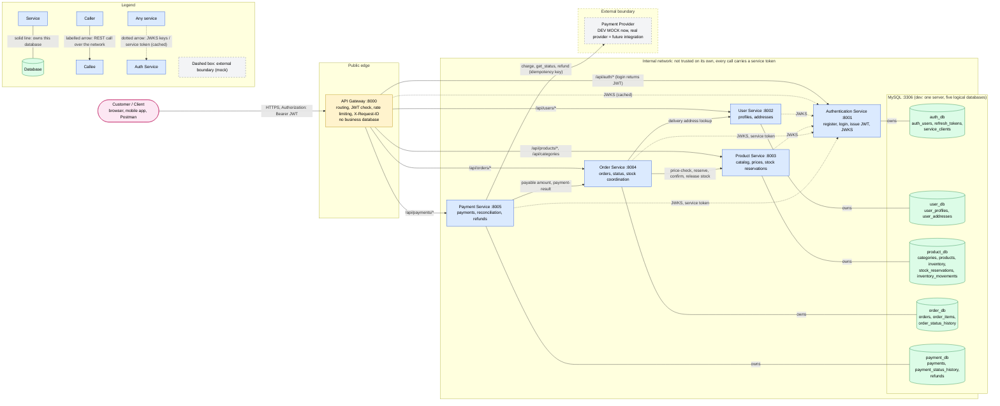

# ShopEase System Architecture

> **Status: proposed design, not implemented.** This is the Day 1 reference architecture for
> the Day 2 build. The payment provider is a **development mock**. The checkout model is
> the two-step checkout (**ADR-13**, accepted 2026-10-29).

ShopEase is a microservices-based e-commerce backend: five FastAPI business services, each
owning one logical MySQL database, behind a single API Gateway.

Related: [service_responsibilities.md](service_responsibilities.md) ·
[database_ownership.md](database_ownership.md) · [rest_api_notes.md](rest_api_notes.md) ·
[service_communication.md](service_communication.md) ·
[checkout_sequence.mmd](checkout_sequence.mmd) ·
[implementation_decisions.md](implementation_decisions.md) ·
Diagram source: [shopease_architecture.mmd](shopease_architecture.mmd)

---

## 1. Architecture Diagram

**Solid lines without arrowheads** show database ownership. **Labelled arrows** show network
calls. **Dotted arrows** show key and token fetches from the Authentication Service (cached).
The **dashed box** is the external payment-provider boundary (mock now, future integration).



---

## 2. Components

| Component | Port (dev) | Owns | Role |
|-----------|-----------|------|------|
| Customer / Client | — | — | Browser, mobile app or Postman. Talks **only** to the gateway |
| API Gateway | 8000 | No business database | Single public entry point: routing, edge JWT check, rate limiting, `X-Request-ID`, CORS |
| Authentication Service | 8001 | `auth_db` | Registration, login, password hashing, JWT issuance, JWKS, service tokens |
| User Service | 8002 | `user_db` | Profiles, contact details, delivery addresses |
| Product Service | 8003 | `product_db` | Catalog, categories, prices, stock and reservations |
| Order Service | 8004 | `order_db` | Orders, line items, status changes, order and stock coordination, expiry job |
| Payment Service | 8005 | `payment_db` | Payment attempts, provider integration, reconciliation, refunds |
| MySQL | 3306 | Hosts five logical databases | One server in development; each database has a single owner |
| Payment Provider | — | — | **Development mock**; a real provider is a future integration behind the same adapter |

Detailed responsibilities: [service_responsibilities.md](service_responsibilities.md).

---

## 3. Connections Explained

### 3.1 Client-facing (through the gateway)

| # | Connection | Protocol and auth | Purpose |
|---|-----------|-------------------|---------|
| C1 | Client → API Gateway | HTTPS (production), `Authorization: Bearer <JWT>` on protected routes | The **only** way in. Service ports are not published in shared or production environments |
| C2 | Gateway → Authentication Service | HTTP, `/api/auth/*`; public routes (register, login, refresh, JWKS) need no token | Account creation and login; **login returns the JWT** |
| C3 | Gateway → User Service | `/api/users/*`, JWT required | Profile and addresses of the caller (`sub`) |
| C4 | Gateway → Product Service | `/api/products/*`, `/api/categories`; reads are public, writes need the admin role | Catalog browsing and admin catalog management |
| C5 | Gateway → Order Service | `/api/orders/*`, JWT required, `Idempotency-Key` on create | Create orders, history, cancellation, fulfilment status |
| C6 | Gateway → Payment Service | `/api/payments/*`, JWT required, `Idempotency-Key` on create; webhooks use the provider's signature | Pay for an order, payment status, admin refunds |

The gateway forwards paths **unchanged** and never routes `/internal/*`.

### 3.2 Service-to-service (internal REST)

| # | Connection | Endpoints | Purpose |
|---|-----------|-----------|---------|
| S1 | Order → Product | `POST /internal/products/price-check`, `POST /internal/reservations`, `.../{order_id}/confirm`, `.../{order_id}/release` | Current prices (never trust client prices); reserve stock on order creation; confirm after payment; release on cancel or expiry |
| S2 | Order → User | `GET /internal/users/{user_id}/addresses/{address_id}` | Copy the delivery address onto the order |
| S3 | Payment → Order | `GET /internal/orders/{order_id}/payable`, `POST /internal/orders/{order_id}/payment-result` | Get the authoritative amount, owner and status; report the payment outcome so Order Service can confirm stock and set `PAID` |
| S4 | Payment → Payment Provider (mock) | Adapter: `charge`, `get_status`, `refund` | Move money. Every call carries an idempotency key. A timeout means *unknown*: reconcile, never re-charge |
| S5 | All services and the gateway → Auth | `GET /api/auth/.well-known/jwks.json`, `POST /internal/auth/service-token` | Public keys to verify JWTs locally; short-lived service tokens for internal calls. Both are **cached**, so Auth is not on the hot path |

Every internal call carries a **service token** with a limited scope (ADR-08), forwards the
user's JWT where it acts for the user, propagates `X-Request-ID`, and has a timeout and a
bounded retry policy ([service_communication.md](service_communication.md) §3–4).

### 3.3 Database ownership (no network calls between databases)

| # | Connection | Rule |
|---|-----------|------|
| D1–D5 | Each service → its own database | Only the owner connects, with its own MySQL user. There are no cross-database queries, joins or foreign keys |

### 3.4 Call graph check
Edges: Gateway → {Auth, User, Product, Order, Payment}; Order → {Product, User}; Payment →
{Order, Provider}; all → Auth (keys and tokens only). There are **no cycles**: Order never
calls Payment, Product and User call nobody, and no service calls the gateway (ADR-11).

---

## 4. JWT Authentication and Authorization Flow

```
1. POST /api/auth/login ──► Gateway ──► Auth: verify password hash, issue JWT
                                        (RS256 proposed: sub, role, exp, iss, aud, jti)
2. Client stores the access token and sends it as  Authorization: Bearer <JWT>
3. Gateway: verify signature + expiry with cached JWKS  → 401 if invalid   (authentication)
4. Service: verify again with cached JWKS                → 401 if invalid   (authentication)
5. Service: check role and ownership, e.g. order.user_id == sub → 403 / 404 (authorization)
6. Internal call: caller adds its service token (scope) + forwards the user's JWT
   → callee checks the service scope AND the user context
```

- **Authentication** (is the token genuine?) happens at the gateway **and** in every service.
- **Authorization** (is this allowed?) happens **only in the owning service**. The gateway
  never decides about roles or ownership.
- Access tokens are short-lived; refresh tokens are rotated and revocable (OPEN-07).

---

## 5. Order, Inventory and Payment Coordination

Two-step checkout (ADR-13). Full sequence with failure branches:
[service_communication.md](service_communication.md) and
[checkout_sequence.mmd](checkout_sequence.mmd).

| Step | Coordinator | What happens | Resulting state |
|------|-------------|--------------|-----------------|
| 1 | Order Service | `POST /api/orders`: price check (S1), address (S2), insert order, reserve stock (S1) | Order `AWAITING_PAYMENT`, reservation with `payment_due_by` |
| 2 | Payment Service | `POST /api/payments`: payable view (S3), record attempt, charge the mock (S4) | Payment `SUCCEEDED`, `FAILED` or `PROCESSING` |
| 3 | Payment → Order | payment-result (S3); Order confirms the reservation (S1) | Order `PAID` (or stays `AWAITING_PAYMENT` after a decline) |
| 4 | Background jobs | Order: expire unpaid orders and release stock. Payment: reconcile `PROCESSING`, retry result delivery | `CANCELLED` / final payment state |
| 5 | Compensation | Stock can't be confirmed after payment → order `CANCELLED`, Payment **refunds** | Payment `REFUNDED` |

Inventory strategy: **reserve on order creation, with an expiry; confirm on payment; release
on cancel or expiry** (OPEN-09).

---

## 6. Database Isolation Rules

1. **One owner per database:** `auth_db`, `user_db`, `product_db`, `order_db`, `payment_db`
   each belong to exactly one service. The **gateway has no business database**.
2. **No cross-service table access.** Data from another service comes only through its API.
3. **No cross-database foreign keys.** External IDs (`user_id`, `product_id`, `order_id`)
   are plain indexed columns. Data that must not change is **snapshotted** (price, name,
   address).
4. **Least-privilege credentials:** a runtime user per service with DML on its own database
   only, and a separate migration user with DDL on its own database only. No service uses
   `root`.
5. **Independent migrations:** one Alembic history per service, run with that service's
   deployment, using expand-and-contract for breaking changes.
6. **Logical, not necessarily physical:** one MySQL server with five databases in
   development (OPEN-02). Moving a database to its own server later is only a configuration
   change.

Details and table lists: [database_ownership.md](database_ownership.md).

---

## 7. Proposed Local Development Ports

| Component | Port | Swagger UI |
|-----------|------|-----------|
| API Gateway | 8000 | — |
| Authentication Service | 8001 | http://localhost:8001/docs |
| User Service | 8002 | http://localhost:8002/docs |
| Product Service | 8003 | http://localhost:8003/docs |
| Order Service | 8004 | http://localhost:8004/docs |
| Payment Service | 8005 | http://localhost:8005/docs |
| MySQL | 3306 | — |

These are **development defaults**, configured through environment variables. In shared or
production environments, only the gateway is exposed. Service ports and MySQL stay on the
internal network.

---

## 8. Security Boundaries

| Boundary | Between | Controls |
|----------|---------|----------|
| **B1 Public edge** | Internet/client ↔ API Gateway | TLS (production), JWT check on protected routes, rate limiting (stricter on login and register), request size limits, CORS, `/internal/*` blocked |
| **B2 Service boundary** | Gateway ↔ services, service ↔ service | Each service verifies the JWT again **and** authorizes (role + ownership); internal calls need a scoped **service token**. The internal network alone is **not** trusted |
| **B3 Data boundary** | Service ↔ its database | Separate MySQL users per service, privileges limited to its own database, secrets from environment/secret store, MySQL not published outside dev |
| **B4 External boundary** | Payment Service ↔ payment provider | Only Payment Service crosses it. Provider keys are secrets. **No card numbers or CVVs** enter ShopEase (client-side tokenization), and webhooks are signature-verified. Currently a **mock** |
| **B5 Secrets and logging** | All components | No passwords, tokens, payment tokens or card data in logs or error bodies. `.env.example` holds placeholders only |

---

## 9. Important Failure Scenarios

| Scenario | Impact | Designed response |
|----------|--------|-------------------|
| **Gateway down** | Whole API unreachable | Run several gateway copies in production; it is stateless and has no database |
| **Auth Service down** | No new logins or registrations | Existing tokens still work: services verify JWTs with **cached** JWKS keys; cached service tokens keep internal calls working until they expire |
| **Product Service down or slow** | No browsing; orders can't be created | Order Service times out (1.5–2s), releases any uncertain reservation, cancels the order and answers `503`. The circuit breaker fails fast |
| **User Service down** | Address lookup fails at checkout | Order creation fails with `503` before any stock is reserved |
| **Order Service down** | No orders; payments can't get the payable amount | Payment Service attempts **no charge** and answers `503`. Delivery of payment results is retried on a bounded schedule |
| **Payment provider timeout** | Charge outcome **unknown** | Payment `PROCESSING`, client gets `202`, reconciliation checks the provider status on a bounded schedule. **Never re-charge**; manual review after the last check |
| **Payment declined** | Order unpaid | Order stays `AWAITING_PAYMENT`; the customer can retry with another method until it expires |
| **Reservation expired before payment completes** | Paid order can't be fulfilled | Order `CANCELLED`, Payment **refunds** automatically |
| **Duplicate client requests** (retries, double clicks) | Risk of double orders or charges | `Idempotency-Key` on orders and payments, one active payment per order, provider idempotency key |
| **MySQL down** (shared dev server) | All services fail | Shared server is a development trade-off (OPEN-02). Production: separate instances, backups, replicas |
| **Cascading slowness** | Threads and connections run out | Timeouts on every call, deadline budgets, at most 1 inline retry, per-dependency circuit breakers |

---

## 10. Out of Scope for the Day 2 MVP

Real payment provider, message broker and transactional outbox (OPEN-05), distributed
tracing backend, Kubernetes, CI/CD pipelines, and a frontend. The design leaves room for
each of them (see [service_communication.md](service_communication.md) §10).
